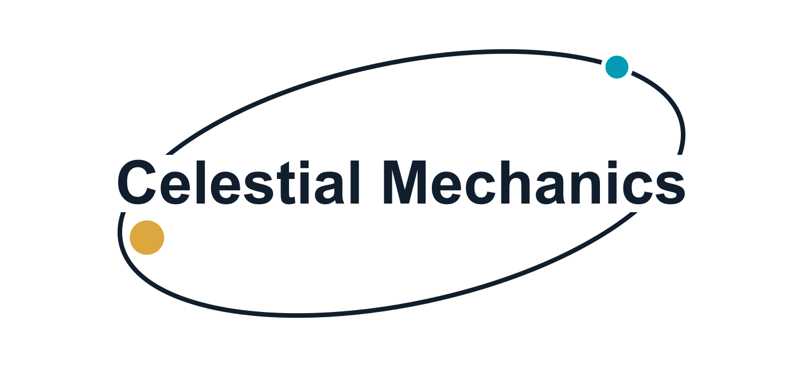

# Himmelmekanikk (Celestial mechanics)

[Norsk](README.md) · **English**

<picture>
  <source media="(prefers-color-scheme: dark)" srcset="assets/logo/celestial-mechanics-en-dark.svg">
  
</picture>

An interactive simulator of Newton's two-body problem. Adjust the masses
and initial conditions to explore circles, ellipses, parabolas and hyperbolas.
The app uses no online services, external fonts or npm dependencies.

The project was developed by Dag-Vidar Krogstad Bauer in collaboration with
**Codex from OpenAI**. The source code is publicly available in this repository.

**[Open the simulator](https://dagvidb.github.io/Himmelmekanikk/)**

## Open the app

Use the link above, or download the simulator for offline use:

1. Open [output/himmelmekanikk.html](output/himmelmekanikk.html) on GitHub and select
   **Download raw file** in the toolbar above the file. Alternatively, select
   **Code → Download ZIP** on the repository's main page and extract the ZIP file.
2. Open the downloaded `himmelmekanikk.html` in a web browser.

This single file contains the entire app and can be shared with others.
It needs no installation, server or internet connection, and is designed
for modern browsers on Windows, macOS and Linux. GitHub's normal file view
shows the source code; use the simulator link or download the file to run it.

## Development

Install Node.js 20 or later to build the app and run the tests.
Neither the app nor the physics tests require `npm install`.

```sh
npm start       # Local development server at http://127.0.0.1:4173
npm test        # Physics tests
npm run build   # Update output/himmelmekanikk.html after source changes
```

The development server listens only on the local machine. GitHub Pages
serves `index.html` with its JavaScript and CSS files.

## Controls

- Mass ratio q = m/M: from the test-particle limit to m = 5 M.
- Initial separation, relative initial speed and angle from the tangent.
- Presets for a circle, ellipse, parabola, hyperbola and two equal masses.
- Pause, restart, playback speed, zoom and fit to view.
- Centre-of-mass frame, a view following M, or the relative orbit.
- Orbital trails, velocity vectors, the Runge–Lenz vector and apsides.

Changing a physical parameter resets time to zero. The speed is kept
fixed when the mass changes, so a new mass can change the type of orbit.
Presets recalculate the speed using the current total mass. The
“Sirkelhastighet” (circular speed) button also selects the tangential
direction. The “Unnslippingsfart” (escape speed) button keeps the selected
direction. The simulator's interface is in Norwegian.

## Physics and units

### From two bodies to one relative orbit

Let $M$ and $m$ be the masses, and define $q=m/M$. Both bodies move.
The relative position $\mathbf r=\mathbf r_m-\mathbf r_M$ obeys

$$
\ddot{\mathbf r}=-\frac{G(M+m)}{r^3}\mathbf r,
\qquad r=\lVert\mathbf r\rVert.
$$

The simulation uses $M$ as the unit of mass and a fixed reference length
$R$ as the unit of length. The corresponding units of speed and time are

$$
v_{\ast}=\sqrt{\frac{GM}{R}},
\qquad t_{\ast}=\sqrt{\frac{R^3}{GM}}.
$$

In these dimensionless units, $G=M=R=1$. Write $\mu=1+q$ for the gravitational parameter. The equation
of motion then becomes

$$
\ddot{\mathbf r}=-\frac{\mu}{r^3}\mathbf r.
$$

Once the relative orbit is known, the positions of both bodies in the
centre-of-mass frame follow directly:

$$
\mathbf r_M=-\frac{q}{1+q}\mathbf r,
\qquad
\mathbf r_m=\frac{1}{1+q}\mathbf r.
$$

At $q=0$, we obtain the test-particle limit: $M$ remains at rest, and
the test particle does not affect the central body. At $q=1$, the bodies
move symmetrically about their common centre of mass.

### Energy, angular momentum and the A-vector

With $\mathbf v=\dot{\mathbf r}$, the specific energy and angular momentum are

$$
\varepsilon=\frac{v^2}{2}-\frac{\mu}{r},
\qquad
\mathbf h=\mathbf r\times\mathbf v.
$$

“Specific” here means per unit of reduced mass, $m_{\mathrm{red}}=Mm/(M+m)$.
The total energy in the centre-of-mass frame is therefore
$E=m_{\mathrm{red}}\varepsilon$, and the angular momentum is
$\mathbf L=m_{\mathrm{red}}\mathbf h$, when the quantities are expressed
in consistent units. At $q=0$, the app uses the limiting values of the
specific quantities.

Both are conserved. Since $\mathbf h$ is constant, the orbit lies in a
fixed plane. For this force law, the Laplace–Runge–Lenz vector is also conserved:

$$
\mathbf A=\mathbf v\times\mathbf h-\mu\hat{\mathbf r},
\qquad
\hat{\mathbf r}=\frac{\mathbf r}{r}.
$$

Its conservation can be checked directly: Newton's acceleration gives
$`\mathbf a\times\mathbf h=\mu\,d\hat{\mathbf r}/dt`$. Since
$\dot{\mathbf h}=\mathbf 0$, the two terms in
$d\mathbf A/dt$ cancel.

For a non-circular, non-radial orbit, $\mathbf A$ points towards periapsis,
the point of smallest separation between the bodies. Its magnitude
determines how far the orbit departs from a circle: the eccentricity is
$e=\lVert\mathbf A\rVert/\mu$. For a circle, $\mathbf A=\mathbf 0$, and
no periapsis direction is singled out.

### The orbit's shape from the conserved quantities

We can find the shape of the orbit without solving for position as a
function of time. Taking the scalar product of $\mathbf A$ with
$\mathbf r$, and writing $h=\lVert\mathbf h\rVert$, gives

$$
\mathbf A\cdot\mathbf r
=(\mathbf v\times\mathbf h)\cdot\mathbf r-\mu r
=h^2-\mu r.
$$

Let $\varphi$ be the angle from $\mathbf A$ to $\mathbf r$. The left-hand
side is then $\mu e r\cos\varphi$. Rearranging gives the polar equation
of a conic section:

$$
r(\varphi)=\frac{p}{1+e\cos\varphi},
\qquad p=\frac{h^2}{\mu}.
$$

For a circle, where $e=0$, the zero direction of the angle can be chosen
freely. Squaring the expression for $\mathbf A$ also gives

$$
e^2=1+\frac{2\varepsilon h^2}{\mu^2}.
$$

For $h\ne 0$, this gives four types of orbit:

| Orbit | Eccentricity | Specific energy |
| --- | --- | --- |
| Circle | $e=0$ | $\varepsilon<0$ |
| Ellipse | $0<e<1$ | $\varepsilon<0$ |
| Parabola | $e=1$ | $\varepsilon=0$ |
| Hyperbola | $e>1$ | $\varepsilon>0$ |

If $h=0$, the motion is radial. In that case, $e=1$ regardless of the
energy, so the table cannot be used to classify the motion. The app
labels this “Radiell bevegelse” (radial motion) and stops if a collision occurs.

For a bound, non-radial orbit, the semimajor axis and orbital period are

$$
a=-\frac{\mu}{2\varepsilon},
\qquad
T=2\pi\sqrt{\frac{a^3}{\mu}}.
$$

The separations at periapsis and apoapsis are
$r_{\mathrm p}=a(1-e)$ and $r_{\mathrm a}=a(1+e)$, respectively.
The circular speed and escape speed at separation
$r$ are

$$
v_{\mathrm c}=\sqrt{\frac{\mu}{r}},
\qquad
v_{\mathrm{esc}}=\sqrt{\frac{2\mu}{r}}.
$$

These are **relative** speeds between the bodies. They therefore depend
on both masses through $\mu=1+q$. To produce a circular orbit, the circular
speed must also be directed tangentially.

### Initial conditions and numerical method

All relative initial positions are $\mathbf r_0=(r_0,0)$. The angle
$\beta$ in the control panel is measured from the positive tangent:

$$
\mathbf v_0=v_0(\sin\beta,\cos\beta).
$$

Zero degrees gives a counterclockwise tangential velocity; positive
angles give an outward radial component. When the mass ratio changes,
the initial speed is kept fixed in the chosen units. The energy, and
often the shape of the orbit, therefore changes.

The engine solves the universal Kepler equation at each instant, using
stable Stumpff functions near the parabolic limit. It does not use Euler
integration, so it does not accumulate integration drift. Floating-point
arithmetic and numerical root finding nevertheless give finite precision.
For radial infall, the model stops at the analytical collision time:
the point-mass potential is singular at $r=0$.

The bodies are point masses. The markers indicate identity and an
approximate mass ratio, not physical radii. Tides, other bodies,
relativity and radiation are not included. The dashed curve is the
predicted orbit; an open orbit continues beyond the view. When a very
elongated ellipse is clipped, only the portion that fits in the view
is shown. Select “Tilpass bane” (fit orbit) to include the bodies'
current positions. Vector arrows are scaled for readability; numerical
values are displayed beside them.

## Reference and validation

Method: J. Wisdom and D. M. Hernandez, “A fast and accurate universal
Kepler solver without Stumpff series”, MNRAS 453 (2015), 3015–3023,
https://doi.org/10.1093/mnras/stv1862. This implementation uses Stumpff
functions with a series near zero and a safeguarded Newton/bisection method.

`npm test` runs the physics tests using Node's built-in test runner.
The tests cover energy, angular momentum, the A-vector, complete
revolutions, Barker's solution for a parabola, hyperbolas, mass ratios,
radial collisions and the extended control range at long elapsed times.

### Optional browser tests

The interface tests use Playwright with an isolated browser profile.
Install the test tool and Chromium if you want to run them:

```sh
npm install --no-save --package-lock=false playwright
npx playwright install chromium
npm run build
npm run test:ui
```

You can instead set the `PLAYWRIGHT_PATH` environment variable to an
existing Playwright installation, and `PLAYWRIGHT_CHANNEL` to `msedge`
or `chrome` to use an installed browser. The tests check orbit types,
controls, mobile viewport widths and the standalone HTML file, among
other things. Screenshots are saved in `output/` and excluded from Git.

## Files

- physics.js: independent calculation engine.
- app.js: controls, rendering and animation.
- index.html and styles.css: user interface.
- physics.test.cjs and ui-test.cjs: verification.
- build.cjs: bundles the app into a single HTML file.
- server.cjs: optional local development server.
- output/himmelmekanikk.html: portable app.
