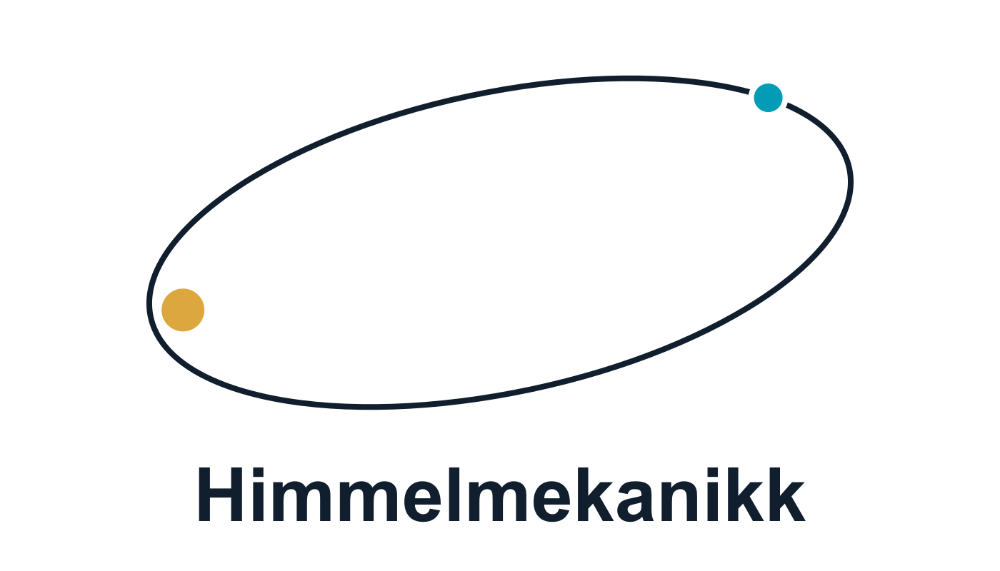

# Himmelmekanikk (Celestial mechanics)

**Norsk** · [English](README.md)

<picture>
  <source media="(prefers-color-scheme: dark)" srcset="assets/logo/himmelmekanikk-no-dark.svg">
  
</picture>

En interaktiv simulator for Newtons tolegemeproblem. Juster masser og
startbetingelser, og utforsk sirkelbaner, ellipser, parabler og hyperbler.
Appen bruker ingen nettjenester, eksterne skrifter eller npm-avhengigheter.

Prosjektet er utviklet av Dag-Vidar Krogstad Bauer i samarbeid med
**Codex fra OpenAI**. Kildekoden er tilgjengelig under [MIT-lisensen](LICENSE).

**[Åpne simulatoren på norsk](https://olympia-academy.github.io/Celestial-Mechanics/?lang=nb)**

Appen finnes på norsk bokmål og engelsk. Lenken over åpner norsk tekst.
Språkvelgeren endrer grensesnittet uten å starte banen på nytt.

## Åpne appen

Simulatoren kan brukes via lenken over eller lastes ned for bruk uten nett:

1. Åpne [output/himmelmekanikk.nb.html](output/himmelmekanikk.nb.html) på GitHub og velg
   **Download raw file** i verktøylinjen over filen. Alternativt: velg
   **Code → Download ZIP** på repositoryets forside og pakk ut ZIP-filen.
2. Åpne den nedlastede `himmelmekanikk.nb.html` i en nettleser.

Denne ene filen inneholder hele appen og kan deles videre. Den krever
ingen installasjon, server eller nettilgang, og er laget for moderne
nettlesere på Windows, macOS og Linux. GitHubs vanlige filvisning viser
kildekoden; bruk simulatorlenken eller last ned filen for å kjøre appen.

Denne utgaven starter på norsk. Begge språk er inkludert og virker uten nett.
[output/himmelmekanikk.html](output/himmelmekanikk.html) starter på engelsk.

## Utvikling

Installer Node.js 20 eller nyere for å bygge appen og kjøre tester.
Ingen `npm install` er nødvendig for appen eller fysikktestene.

```sh
npm start       # Lokal utviklingsserver på http://127.0.0.1:4173
npm test        # Fysikk- og lokalservertester
npm run build   # Oppdater begge portable HTML-filer etter kildeendringer
```

Utviklingsserveren lytter bare lokalt. GitHub Pages viser `index.html`
med de tilhørende JavaScript- og CSS-filene. Bruk `?lang=nb` eller `?lang=en`
for å lenke direkte til ønsket språk.

## Kontroller

- Masseforholdet q = m/M: fra testpartikkelgrensen til m = 5 M.
- Startavstand, relativ startfart og vinkel fra tangenten.
- Forhåndsvalg for sirkel, ellipse, parabel, hyperbel og to like masser.
- Pause, start på nytt, tempo, zoom og tilpasning av utsnittet.
- Felles massesenter, visning som følger M, eller den relative banen.
- Banespor, hastighetsvektorer, Runge-Lenz-vektor og apsider.

Fysiske parameterendringer setter tiden tilbake til null. Farten beholdes
når massen endres; dermed kan den nye massen endre banetype. Forhåndsvalg
beregner farten på nytt med den gjeldende totale massen. Knappen
«Sirkelhastighet» velger også tangentiell retning. Knappen
«Unnslippingsfart» beholder den valgte retningen.

## Fysikk og enheter

### Fra to legemer til én relativ bane

La $M$ og $m$ være massene, og sett $q=m/M$. Begge legemene beveger seg.
Den relative posisjonen $\mathbf r=\mathbf r_m-\mathbf r_M$ oppfyller

$$
\ddot{\mathbf r}=-\frac{G(M+m)}{r^3}\mathbf r,
\qquad r=\lVert\mathbf r\rVert.
$$

Simuleringen bruker $M$ som masseenhet og en fast referanselengde $R$ som
lengdeenhet. De tilhørende enhetene for fart og tid er

$$
v_{\ast}=\sqrt{\frac{GM}{R}},
\qquad t_{\ast}=\sqrt{\frac{R^3}{GM}}.
$$

I disse dimensjonsløse enhetene er $G=M=R=1$. Skriv
$\mu=1+q$ for gravitasjonsparameteren. Da blir bevegelsesligningen

$$
\ddot{\mathbf r}=-\frac{\mu}{r^3}\mathbf r.
$$

Når den relative banen er kjent, følger begge legemenes posisjoner i
massesentersystemet direkte:

$$
\mathbf r_M=-\frac{q}{1+q}\mathbf r,
\qquad
\mathbf r_m=\frac{1}{1+q}\mathbf r.
$$

Ved $q=0$ får vi testpartikkelgrensen: $M$ står i ro, og testpartikkelen
påvirker ikke sentrallegemet. Ved $q=1$ beveger legemene seg symmetrisk
om det felles massesenteret.

### Energi, dreieimpuls og A-vektoren

Med $\mathbf v=\dot{\mathbf r}$ er den spesifikke energien og dreieimpulsen

$$
\varepsilon=\frac{v^2}{2}-\frac{\mu}{r},
\qquad
\mathbf h=\mathbf r\times\mathbf v.
$$

«Spesifikk» betyr her per redusert masse, $m_{\mathrm{red}}=Mm/(M+m)$.
Dermed er den totale energien i massesentersystemet
$E=m_{\mathrm{red}}\varepsilon$, og dreieimpulsen er
$\mathbf L=m_{\mathrm{red}}\mathbf h$, når størrelsene uttrykkes i
konsistente enheter. Ved $q=0$ bruker appen grenseverdiene for de
spesifikke størrelsene.

Begge er bevart. Siden $\mathbf h$ er konstant, ligger banen i et fast
plan. For denne kraftloven er også Laplace–Runge–Lenz-vektoren bevart:

$$
\mathbf A=\mathbf v\times\mathbf h-\mu\hat{\mathbf r},
\qquad
\hat{\mathbf r}=\frac{\mathbf r}{r}.
$$

Bevaringen kan kontrolleres direkte: Newtons akselerasjon gir
$`\mathbf a\times\mathbf h=\mu\,d\hat{\mathbf r}/dt`$. Siden
$\dot{\mathbf h}=\mathbf 0$, kansellerer de to leddene i
$d\mathbf A/dt$ hverandre.

For en ikke-sirkulær, ikke-radiell bane peker $\mathbf A$ mot periapsis,
punktet med minst avstand mellom legemene. Lengden bestemmer hvor mye
banen avviker fra en sirkel: eksentrisiteten er $e=\lVert\mathbf A\rVert/\mu$.
For en sirkel er $\mathbf A=\mathbf 0$, og ingen periapsisretning er utpekt.

### Baneformen fra de bevarte størrelsene

Vi kan finne baneformen uten å løse for posisjonen som funksjon av tiden.
Skalarproduktet av $\mathbf A$ og $\mathbf r$ gir, med $h=\lVert\mathbf h\rVert$,

$$
\mathbf A\cdot\mathbf r
=(\mathbf v\times\mathbf h)\cdot\mathbf r-\mu r
=h^2-\mu r.
$$

La $\varphi$ være vinkelen fra $\mathbf A$ til $\mathbf r$. Da er venstresiden
$\mu e r\cos\varphi$. Ved å samle leddene får vi kjeglesnittets polarligning:

$$
r(\varphi)=\frac{p}{1+e\cos\varphi},
\qquad p=\frac{h^2}{\mu}.
$$

For en sirkel, der $e=0$, kan vinkelens nullretning velges fritt.
Å kvadrere uttrykket for $\mathbf A$ gir dessuten

$$
e^2=1+\frac{2\varepsilon h^2}{\mu^2}.
$$

For $h\ne 0$ gir dette fire banetyper:

| Bane | Eksentrisitet | Spesifikk energi |
| --- | --- | --- |
| Sirkel | $e=0$ | $\varepsilon<0$ |
| Ellipse | $0<e<1$ | $\varepsilon<0$ |
| Parabel | $e=1$ | $\varepsilon=0$ |
| Hyperbel | $e>1$ | $\varepsilon>0$ |

Hvis $h=0$, er bevegelsen radiell. Da blir $e=1$ uansett energi, så
tabellen kan ikke brukes til å klassifisere bevegelsen. Appen viser
dette som «Radial motion» (radiell bevegelse) og stopper ved en eventuell kollisjon.

For en bundet, ikke-radiell bane er store halvakse og omløpstid

$$
a=-\frac{\mu}{2\varepsilon},
\qquad
T=2\pi\sqrt{\frac{a^3}{\mu}}.
$$

Avstandene ved periapsis og apoapsis er henholdsvis
$r_{\mathrm p}=a(1-e)$ og $r_{\mathrm a}=a(1+e)$.
Sirkel- og unnslippingsfarten ved avstand $r$ er

$$
v_{\mathrm c}=\sqrt{\frac{\mu}{r}},
\qquad
v_{\mathrm{esc}}=\sqrt{\frac{2\mu}{r}}.
$$

Dette er **relative** hastigheter mellom legemene. Derfor avhenger de
av begge massene gjennom $\mu=1+q$. For å gi en sirkelbane må
sirkelhastigheten dessuten være rettet tangentialt.

### Startbetingelser og beregningsmetode

Alle relative startposisjoner er $\mathbf r_0=(r_0,0)$. Vinkelen
$\beta$ i kontrollpanelet måles fra den positive tangenten:

$$
\mathbf v_0=v_0(\sin\beta,\cos\beta).
$$

Null grader gir tangentiell fart mot klokken; positive vinkler gir en
utoverrettet radialkomponent. Når masseforholdet endres, beholdes
startfarten i de faste enhetene. Dermed endres energien og ofte baneformen.

Motoren løser den universelle Kepler-ligningen for hvert tidspunkt,
med stabile Stumpff-funksjoner ved parabelgrensen. Den bruker ikke
Euler-integrasjon og akkumulerer derfor ikke integrasjonsdrift.
Flyttall og den numeriske rotløsningen gir likevel endelig presisjon.
Ved radielt innfall stopper modellen ved den analytiske kollisjonstiden:
punktmassepotensialet er singulært ved $r=0$.

Legemene er punktmasser. Markørene angir identitet og omtrentlig
masseforhold, ikke fysiske radier. Ingen tidevann, andre legemer,
relativitet eller stråling er inkludert. Den stiplede kurven er den
beregnede banen; en åpen bane fortsetter utenfor utsnittet. Når en
svært lang ellipse klippes, vises bare den delen som passer i utsnittet.
Velg «Tilpass bane» for å inkludere legemenes nåværende posisjoner.
Vektorpilenes lengder er tilpasset lesbarheten; tallverdiene står ved siden av.

## Kilde og kontroll

Metode: J. Wisdom og D. M. Hernandez, «A fast and accurate universal
Kepler solver without Stumpff series», MNRAS 453 (2015), 3015–3023,
https://doi.org/10.1093/mnras/stv1862. Implementasjonen her bruker
Stumpff-funksjoner med serie nær null og en sikret Newton-/halveringsmetode.

`npm test` kjører fysikk- og lokalservertestene med Nodes innebygde testverktøy.
Testene dekker energi, dreieimpuls, A-vektor, hele omløp, parabelens
Barker-løsning, hyperbler, masseforhold, radielle kollisjoner og det
utvidede kontrollområdet ved lange tider. De dekker også tegning av nesten
radielle ellipser. Servertestene kontrollerer filtyper og ugyldige URL-er.

### Valgfrie nettlesertester

Grensesnitttestene bruker Playwright med en isolert nettleserprofil.
Installer testverktøyet og Chromium hvis du vil kjøre disse:

```sh
npm ci
npx playwright install chromium
npm run build
npm run test:ui
```

Sett eventuelt miljøvariabelen `PLAYWRIGHT_PATH` til en eksisterende
Playwright-installasjon, og `PLAYWRIGHT_CHANNEL` til `msedge` eller
`chrome` for å bruke en installert nettleser. Testene kontrollerer blant
annet banetyper, kontroller, tallvisning på mobil, språkbytte og begge HTML-filene.
Skjermbilder lagres i `output/` og holdes utenfor Git.

GitHub Actions kjører kontrollene ved push og pull requests, og kontrollerer
at de versjonerte HTML-filene samsvarer med en ny bygging. Playwright har en
låst versjon og brukes bare til utvikling; selve appen har ingen kjøretidsavhengigheter.

## Filer

- physics.js: uavhengig beregningsmotor.
- app.js: kontroller, visning og animasjon.
- i18n.js: felles engelske og norske grensesnitttekster.
- index.html og styles.css: brukergrensesnitt.
- physics.test.cjs, server.test.cjs og ui-test.cjs: verifikasjon.
- build.cjs: samler appen i to HTML-utgaver som kan brukes hver for seg.
- server.cjs: valgfri lokal utviklingsserver.
- output/himmelmekanikk.html: portabel app med engelsk som startspråk.
- output/himmelmekanikk.nb.html: portabel app med norsk som startspråk.
- LICENSE: MIT-lisens.
